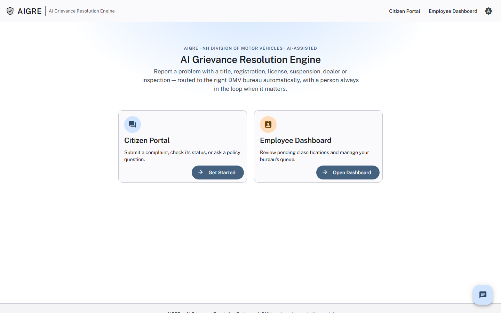
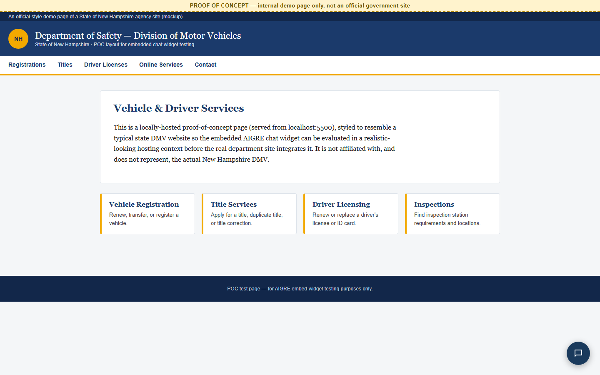
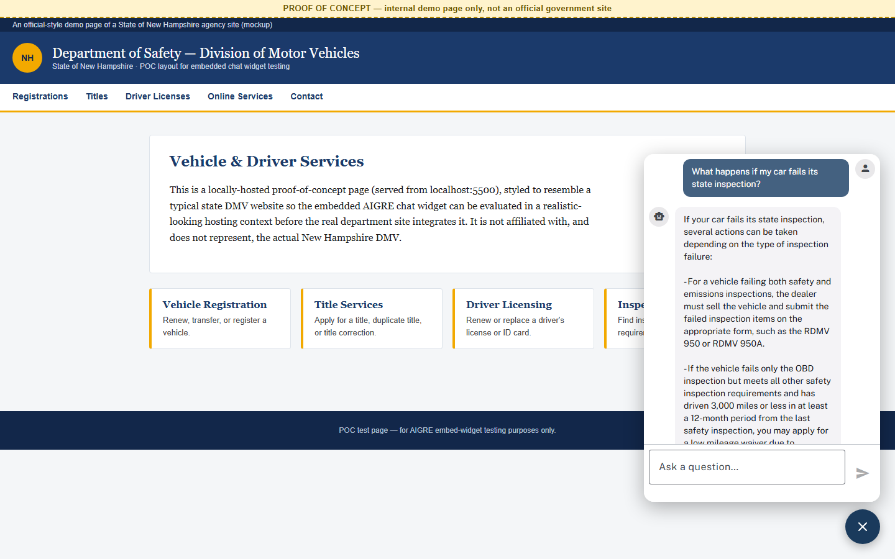
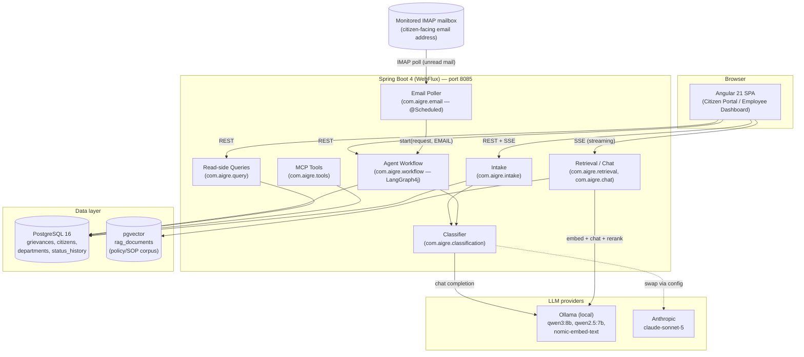
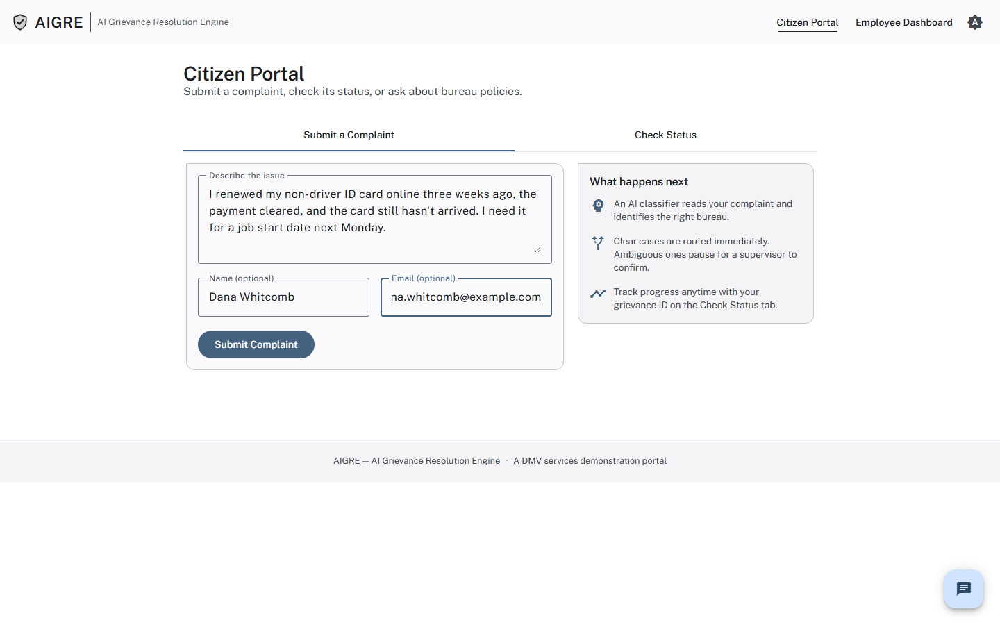
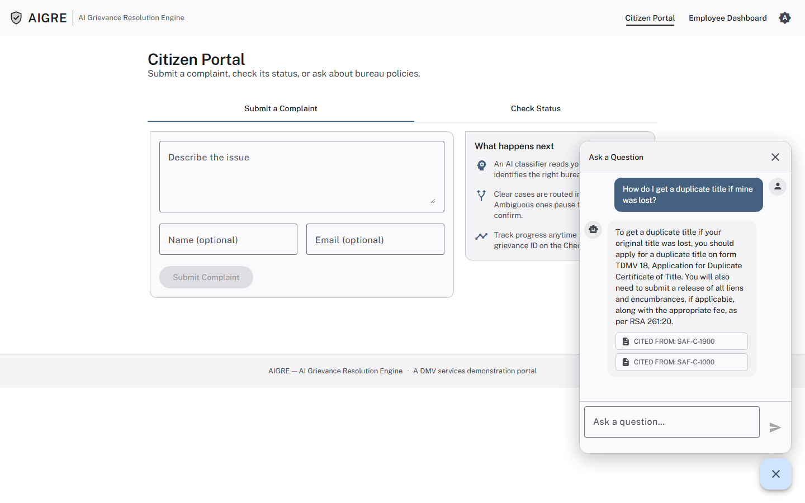
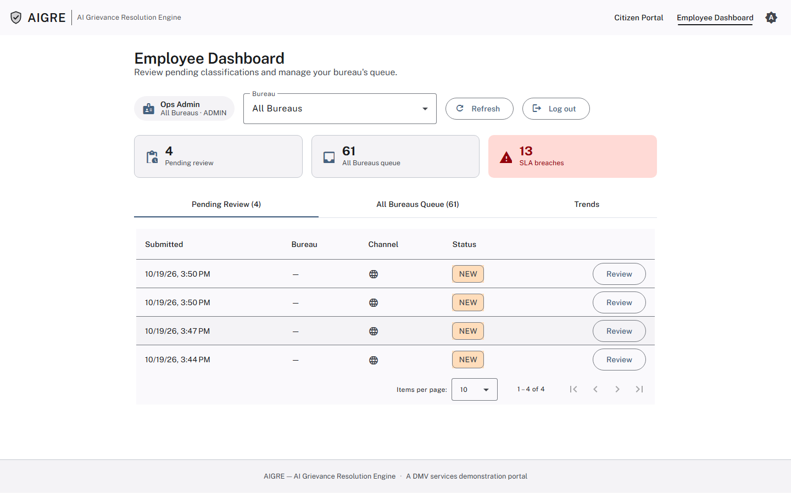
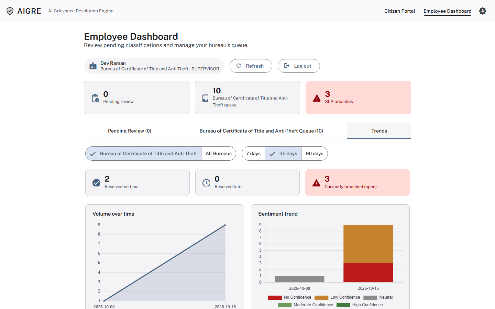

# AIGRE — AI Grievance Resolution Engine

**A G2C (government-to-citizen) system for intake, AI classification, routing, and
resolution tracking of complaints to the bureaus of a state Division of Motor
Vehicles.** A citizen reports a title that never arrived, a suspension they believe is
wrong, a dealer sitting on their registration paperwork, a disputed inspection — by web
form or by email — and AIGRE classifies it, assigns one of the five NH DMV bureaus and a
priority, checks for duplicates, computes an SLA deadline, and routes it to that
bureau's queue, pausing for a human decision whenever its own confidence is genuinely
too low to act alone.

The same code still runs the original city-services build (six city departments,
potholes and streetlights) as a second **domain profile** — see
[Domain profiles](#domain-profiles-dmv-bureaus-or-city-departments).

Built as a full-stack reference implementation of applied LLM engineering: not "call an
API and hope," but classification with a defined correctness contract, retrieval that's
measured against labeled eval data, and a human approval gate that's a first-class
workflow state rather than a bolted-on afterthought.



---

## Contents

- [What it does](#what-it-does)
- [Where AI is actually used](#where-ai-is-actually-used)
- [What's agentic here (and what isn't)](#whats-agentic-here-and-what-isnt)
- [Embedding on an existing site (brownfield integration)](#embedding-on-an-existing-site-brownfield-integration)
- [Domain profiles: DMV bureaus or city departments](#domain-profiles-dmv-bureaus-or-city-departments)
- [Tech stack](#tech-stack)
- [Architecture at a glance](#architecture-at-a-glance)
- [Screenshots](#screenshots)
- [Getting started](#getting-started)
- [Demo credentials](#demo-credentials)
- [Documentation](#documentation)
- [Testing](#testing)
- [Project status](#project-status)
- [Known limitations](#known-limitations)

**New here? Read in this order:**
1. This README: what the system does and where AI is used.
2. [`docs/APP_WALKTHROUGH.md`](docs/APP_WALKTHROUGH.md): every screen, with real inputs and outputs.
3. [`docs/ARCHITECTURE.md`](docs/ARCHITECTURE.md): components, data flow, data model, deployment.
4. [`docs/RUNNING.md`](docs/RUNNING.md): get it running locally, then [`docs/TEST_SCENARIOS.md`](docs/TEST_SCENARIOS.md) for the tests.
5. [`PROJECT.md`](PROJECT.md) as a reference: the build log with the reasoning behind each decision. Search it rather than reading it end to end.

---

## What it does

**For citizens** (`/citizen`, no login required):
- Submit a complaint as free text — no bureau dropdown to guess wrong (is a lost title
  a Registration problem or a Title problem?). AI infers the bureau, category, and
  priority.
- Get an instant receipt: assigned bureau, priority, SLA due date — or, if the
  system genuinely can't tell what's being reported, a request for more detail instead
  of a bad guess.
- Check the status of an existing complaint by ID at any time.
- Reopen a closed complaint if the issue recurs (priority bumps up a tier automatically).
- Ask policy questions via a floating chat launcher, available on every page
  ("How do I get a duplicate title if mine was lost?") and get an answer grounded in
  the actual NH motor vehicle rules (the Saf-C chapters), with a citation — or an
  honest "I don't have that" instead of a fabricated answer.
- Email a complaint instead of using the form — a monitored inbox is polled on a
  schedule and every message goes through the identical pipeline as a portal
  submission.

**For bureau employees** (`/employee`, real login required):
- Review the **Pending Review** queue — complaints the AI wasn't confident enough to
  route on its own, shown with the model's own reasoning, so the reviewer knows *why*
  it paused, not just that it did.
- Work a bureau queue: status, category, priority, SLA due date, and duplicate
  links, with an at-a-glance channel indicator (email vs. portal).
- Mark complaints resolved or closed, or resume a paused review with a decision.
- View a **Trends** dashboard: complaint volume, sentiment distribution, top
  categories, priority breakdown, and an SLA compliance snapshot.
- A division-wide **ADMIN** role gets every bureau's data in one view, with an
  optional bureau filter, instead of being scoped to one bureau like every other role.
  Complaints too vague to assign to any bureau wait in the ADMIN's Pending Review queue.

The five bureaus follow Saf-C 102.08(c), the NH rule that organizes the division:

| Id | Bureau | Owns |
|---|---|---|
| `REG` | Registration Bureau | Registrations and renewals, plates (standard, vanity, specialty), hardship and apportioned (IRP) registration |
| `DL` | Driver Licensing Bureau | Licenses and non-driver IDs, REAL ID, road and knowledge tests, CDLs, ignition interlock |
| `FR` | Financial Responsibility Administration Bureau | Suspensions and revocations, restoration, proof of insurance and SR-22, record points |
| `TITLE` | Bureau of Certificate of Title and Anti-Theft | Titles, duplicates and corrections, liens, VIN problems, salvage, stolen vehicles |
| `DEALER` | Dealer Bureau (dealer and inspection station sections) | Dealer conduct and paperwork, dealer plates, inspection stations, failed or disputed inspections |

The boundaries overlap the way citizens experience them — a "license problem" that is
really a suspension (`DL` vs. `FR`), a registration blocked by a title error (`REG` vs.
`TITLE`), a dealer who never delivered the title (`DEALER`, not `TITLE`) — so the
classifier has to make real judgment calls. The bureau definitions in the classifier
prompt spell out each of those boundaries. Pothole, streetlight and other city-service
complaints come back as *not something this portal handles* rather than being forced
into a bureau.

---

## Where AI is actually used

Four distinct, purpose-built uses — each with a defined correctness contract and a
human checkpoint where the model's confidence is genuinely insufficient. Full detail,
including the actual prompts and measured accuracy numbers, is in
[`docs/ARCHITECTURE.md`](docs/ARCHITECTURE.md#where-ai-is-used-the-core-of-this-doc).

1. **Grievance classification** — one structured LLM call determines department,
   category, priority, confidence, and sentiment. Reason-before-verdict prompting (the
   model justifies itself before a machine-parsed result line), a deterministic
   priority rubric the model *applies* rather than invents, and explicit permission to
   say "not confident" instead of forcing a guess. On 42 labeled DMV complaints the
   local Ollama classification model (`qwen3:8b`) routes **40/42 (95.2%)** to the right
   bureau. On the original city build's 91-case set, Anthropic's Claude Sonnet 5 scored
   ~95.6% and `qwen3:8b` 89.0% (up from `qwen2.5:7b`'s 65.9–86.8%). The local model
   stays the default (free, offline) with the stronger model one config line away.
2. **Retrieval-augmented chat** — hybrid vector + full-text search over 16 chapters of
   the NH motor vehicle administrative rules (Saf-C, 3,310 chunks), LLM-reranked (not
   cosine-only — a measured false positive proved raw similarity alone isn't good
   enough), answered strictly from the retrieved text with a citation, refusing rather
   than fabricating when the corpus doesn't have the answer. 12/16 retrieval eval
   questions put the expected chapter first; the four misses are documented in
   [`PROJECT.md`](PROJECT.md).
3. **Agentic workflow with a human approval gate** — a LangGraph4j state graph
   (`classify → human_review (if unconfident) → commit`) that genuinely *pauses*
   execution — not just flags a row — when confidence is too low, and resumes only when
   a supervisor makes a decision. The single most deliberate AI-safety mechanism in the
   system.
4. **MCP tool server** — 5 grievance operations (status lookup, SLA check, duplicate
   chain walk, status update, reopen) exposed over the real Model Context Protocol
   (Streamable HTTP), so an agent can operate on the system the same way a human uses
   the dashboard. The citizen chat uses the read-only ones itself; the endpoint accepts
   loopback connections only, since MCP carries no login.

Plus two cross-cutting concerns: a **PII redaction guardrail** on every citizen
free-text field, and **observability** (every LLM/retrieval call timed and tagged under
one Micrometer metric family, scraped in Prometheus format) — because "the critic step
was 53% of total runtime" is the kind of thing you should never have to guess about.

---

## What's agentic here (and what isn't)

"Agentic" means the model has autonomy over *what action to take next*, not just what
text to generate. Two parts of this system genuinely qualify; the rest is deliberately
plain LLM calls wrapped in code that does the deciding.

**Agentic:**

- **Live tool-calling in the citizen chat** (`CitizenChatAssistant`, `ChatController`).
  The model decides, per question, whether to answer from the retrieved RAG context or
  call one of AIGRE's own MCP tools (`get_grievance_status`, `check_sla_status`,
  `find_duplicate_chain`) instead — the code never tells it which to do. Confirmed live
  (on the city build): a question outside a department-scoped corpus returned zero RAG
  matches, and the model *on its own* fell back to calling `check_sla_status` for a real grievance
  rather than saying it didn't know.
- **The human-review workflow graph** (`GrievanceWorkflowGraphConfig`, LangGraph4j) — a
  stateful, multi-step orchestration (`classify → human_review (if unconfident) →
  commit`) that makes a routing decision based on model confidence, genuinely *pauses*
  execution rather than just flagging a row, and resumes only on a human decision — with
  Postgres-backed checkpointing so a paused run survives an app restart.

**Not agentic, on purpose:** `LlmGrievanceClassifier.classify()` (one system prompt, one
complaint, one structured JSON result — no tool access, no say over what happens next)
and `RetrievalService`'s LLM-rerank step (same shape — score and return). Both are
single-shot calls; the surrounding code, not the model, decides what happens with the
result.

**Planned, not built:** [`docs/FUTURE_MULTI_AGENCY_ROADMAP.md`](docs/FUTURE_MULTI_AGENCY_ROADMAP.md)
lays out making classification itself agentic — moving it from a single-shot call to an
`AiServices`-backed agent with live tool access, so it could call a brownfield agency's
own `find_similar_cases`-shaped tool mid-classification instead of reasoning from raw
text alone.

---

## Embedding on an existing site (brownfield integration)

The DMV already runs its own website, so it doesn't need to send citizens to AIGRE —
it can embed the same chat widget directly, with one script tag:

```html
<script src="https://your-aigre-host/embed.js"></script>
```

That's the whole integration. The script injects a floating chat button on the host
page; clicking it opens a same-origin AIGRE iframe. With no `data-department` the widget
is **agency-wide**: it answers from every bureau's rules, which is what a division-level
site wants. A bureau's own page can scope it to that bureau's corpus instead —
`data-department="TITLE"` — so a question about another bureau's rules gets an honest
"I don't know," not a cross-bureau answer (the scoping was verified live against the
city build; see `PROJECT.md`).

The screenshots below are a real proof-of-concept page, locally styled to resemble a
typical state DMV site so the widget can be evaluated in a realistic hosting context —
**it is not the real dmv.nh.gov and isn't affiliated with the actual New Hampshire
DMV**, just a stand-in for "the agency's existing website."

| | |
|---|---|
|  Embedded on a DMV-styled page — closed |  An inspection question, answered from the Saf-C rules with citations |

**Embedding is allowlisted, not open to any site that includes the script.** An admin
registers which origins may embed a bureau's widget; nothing renders on an unregistered
origin — the browser itself refuses to display it (enforced via a
`Content-Security-Policy: frame-ancestors` header, not just an app-level check). The
agency-wide widget may be framed by any origin registered for any bureau:

```
curl -s -X POST http://localhost:8085/admin/departments/REG/embed-origins ^
  -H "Content-Type: application/json" ^
  -H "Authorization: Bearer <ADMIN_TOKEN>" ^
  -d "{\"origin\": \"https://dmv.example.gov\"}"
```

The API path says `departments`: code, APIs and tables call every routing unit a
department, and only the UI says "Bureau".

Because the widget's chat requests happen *inside* the iframe (same origin as AIGRE,
not the host page), no CORS changes are needed at all — only a framing decision. Full
design writeup, including the live cross-department-leakage and unregistered-origin
tests, is in `PROJECT.md`.

---

## Domain profiles: DMV bureaus or city departments

AIGRE was first built for a city — six departments (Transportation, Public Works, Health
& Human Services, Education, Housing, Environmental Protection), a ~120-document policy
corpus, potholes and streetlights. The routing unit was already data, so retargeting it
at the DMV became configuration rather than a fork: a Spring profile picks the agency's
routing units, classifier prompt, policy corpus, UI wording and database.

| | `dmv` profile (this README) | Default profile (city) |
|---|---|---|
| Routing units | 5 NH DMV bureaus | 6 city departments |
| Corpus | `test-data/dmv/documents/` (16 Saf-C chapters) | `test-data/documents/` |
| Database | `aigre_dmv` | `aigre` |
| UI wording | "Bureau" | "Department" |
| Activate | `SPRING_PROFILES_ACTIVE=dmv` plus the `aigre_dmv` datasource URL | No profile |

Everything in this README and the walkthrough describes the DMV deployment. The city
build keeps its own tests, labeled eval set and demo data, and much of the build log in
`PROJECT.md` was written against it. Details:
[`docs/ARCHITECTURE.md`](docs/ARCHITECTURE.md#domain-profiles).

---

## Tech stack

| Layer | Technology |
|---|---|
| Backend language/runtime | Java 21 |
| Backend framework | Spring Boot 4.0.6 (WebFlux — reactive, non-blocking) |
| LLM orchestration | LangChain4j 1.18.0 |
| Agentic workflow / graph orchestration | LangGraph4j 1.8.20 |
| Tool-exposure protocol | Spring AI 2.0.0 GA (MCP server, Streamable HTTP) |
| Vector store | pgvector (PostgreSQL extension) |
| LLM providers | Ollama (local, default) — `qwen3:8b` (classification), `qwen2.5:7b` (chat + rerank), `nomic-embed-text` (embeddings); Anthropic (`claude-sonnet-5`) as a switchable alternative |
| Database | PostgreSQL 16 (`pgvector/pgvector:pg16`) |
| Frontend framework | Angular 21 (standalone components, signals) |
| Frontend UI kit | Angular Material 21 (Material 3) |
| Charts | Chart.js 4.5.1 via ng2-charts 10.0.0 |
| Email ingestion | Jakarta Mail (IMAP), polled on a schedule |
| Build tools | Maven (backend), Angular CLI / esbuild (frontend) |

No Python, no LangChain (Python) — this is a Java-native implementation of the same
patterns, end to end.

---

## Architecture at a glance



Single Spring Boot application — no microservice boundary between intake,
classification, RAG, and the agent workflow, just distinct packages under
`com.aigre.*`. The frontend is a separate Angular SPA that can either run its own dev
server (proxied to the backend) or be built and served *by* the backend as static
content, so the whole app is reachable on one origin/port — see
[`docs/RUNNING.md`](docs/RUNNING.md#exposing-the-app-to-the-internet-optional) for why
that matters (tunneling the app to the internet without deploying anywhere).

Two intake channels — the portal and a polled IMAP mailbox — both funnel into the exact
same `GrievanceWorkflowService.start()` entry point, so classification, duplicate
detection, human-review pausing, and SLA computation behave identically regardless of
which channel a complaint arrived through. Full component breakdown, sequence
diagrams, and the data model are in [`docs/ARCHITECTURE.md`](docs/ARCHITECTURE.md).

---

## Screenshots

| | |
|---|---|
|  Citizen intake form |  Floating policy chat, citing the Saf-C rules |
|  Pending Review — complaints too vague to assign a bureau |  Trends for the Title & Anti-Theft bureau |

The full illustrated tour of every screen, for both the citizen and employee sides —
including the human-review pause/resume flow and the bureau dashboards — is in
[`docs/APP_WALKTHROUGH.md`](docs/APP_WALKTHROUGH.md).

---

## Getting started

Full setup instructions (Postgres, Ollama, seeding, running both servers, and
optionally exposing the app to the internet via Cloudflare Tunnel) are in
[`docs/RUNNING.md`](docs/RUNNING.md). Condensed version:

```
:: 1. Postgres + pgvector, with a database for the DMV profile
docker run -d --name aigre-pg -e POSTGRES_DB=aigre -e POSTGRES_USER=aigre -e POSTGRES_PASSWORD=aigre_dev -p 5434:5432 -v aigre-pg-data:/var/lib/postgresql/data pgvector/pgvector:pg16
docker exec aigre-pg psql -U aigre -d aigre -c "CREATE DATABASE aigre_dmv"
docker exec aigre-pg psql -U aigre -d aigre_dmv -c "CREATE EXTENSION IF NOT EXISTS vector"

:: 2. Ollama (https://ollama.com)
ollama pull qwen2.5:7b
ollama pull qwen3:8b
ollama pull nomic-embed-text

:: 3. Backend on :8085, DMV profile (first boot creates the schema and the five bureaus)
set SPRING_PROFILES_ACTIVE=dmv
set SPRING_DATASOURCE_URL=jdbc:postgresql://localhost:5434/aigre_dmv
mvn spring-boot:run

:: 4. In a second window: demo data, then the Saf-C corpus (the reset needs an ADMIN token)
docker exec -i aigre-pg psql -U aigre -d aigre_dmv < test-data\dmv\sql\seed.sql
curl -s -X POST http://localhost:8085/auth/login -H "Content-Type: application/json" -d "{\"username\":\"ops.admin\",\"password\":\"Demo1234!\"}"
curl -X POST -H "Authorization: Bearer <ADMIN_TOKEN>" "http://localhost:8085/ingest/reset?confirm=true"

:: 5. Frontend on :4200
cd frontend
npm install
npm start
```

For the city build, skip the `aigre_dmv` database and both `set` lines, and seed with
`test-data\sql\seed.sql` against `aigre` instead
([`docs/RUNNING.md`](docs/RUNNING.md#4-seed-data)).

Requires JDK 21, Maven, Docker, Ollama, and Node.js 22+. No API key needed by default —
Ollama runs fully offline; Anthropic is an optional one-line config swap.

To run it on a second machine (app + Postgres in Docker, Ollama staying on a GPU box),
optionally published on your own domain through a Cloudflare tunnel, see
[`docs/RUNNING.md`](docs/RUNNING.md#splitting-across-two-machines-unraid-deployment-optional)
and `.env.example`.

---

## Demo credentials

Password for every seeded account: **`Demo1234!`**

> These are public, committed demo credentials. Before exposing any deployment beyond
> your own machine or LAN, replace the password on every account (`docs/RUNNING.md`,
> step e of the two-machine setup) and set your own `SECURITY_JWT_SECRET`.

| Username | Bureau | Role |
|---|---|---|
| `erin.callahan` / `victor.osei` | Registration (`REG`) | AGENT / SUPERVISOR |
| `hannah.pruitt` / `luis.ferreira` | Driver Licensing (`DL`) | AGENT / SUPERVISOR |
| `maya.lindqvist` / `owen.brightwater` | Financial Responsibility (`FR`) | AGENT / SUPERVISOR |
| `priscilla.moreau` / `dev.raman` | Title & Anti-Theft (`TITLE`) | AGENT / SUPERVISOR |
| `colleen.shaw` / `tomas.novak` | Dealers & Inspections (`DEALER`) | AGENT / SUPERVISOR |
| `ops.admin` | *(all bureaus)* | ADMIN |

AGENT can view their bureau's queue read-only; SUPERVISOR can additionally resume a
paused review and move complaints through their lifecycle (start work, resolve, close);
ADMIN gets every bureau at once. The city build has its own accounts, listed in
[`docs/RUNNING.md`](docs/RUNNING.md#4-seed-data).

---

## Documentation

| Doc | What's in it |
|---|---|
| [`docs/ARCHITECTURE.md`](docs/ARCHITECTURE.md) | System design, where and how AI is used, component breakdown, sequence diagrams, data model, key design decisions, known limitations |
| [`docs/RUNNING.md`](docs/RUNNING.md) | Full local setup, seeding, switching LLM providers, exposing the app to the internet, and the two-machine Docker deployment (with `docker-compose.yml` and `.env.example`) |
| [`docs/APP_WALKTHROUGH.md`](docs/APP_WALKTHROUGH.md) | Screen-by-screen tour of the citizen and employee experiences, with real input/output examples |
| [`docs/TEST_SCENARIOS.md`](docs/TEST_SCENARIOS.md) | Automated test suites, the 10 domain routing scenarios the classifier is designed against, and a manual QA checklist |
| [`docs/DEPARTMENT_ONBOARDING.md`](docs/DEPARTMENT_ONBOARDING.md) | How to onboard a new bureau (or city department) — including pulling its policy PDFs from a public URL — with no code redeploy |
| [`docs/FUTURE_INFRASTRUCTURE_GRAPH.md`](docs/FUTURE_INFRASTRUCTURE_GRAPH.md) | **Not built; city build only.** A candidate future enhancement — root-causing clusters of complaints back to a shared upstream infrastructure failure (a water main, a power line) via network reachability, and why that's the one use case in this project that would actually justify graph-database technology |
| [`docs/FUTURE_MULTI_AGENCY_ROADMAP.md`](docs/FUTURE_MULTI_AGENCY_ROADMAP.md) | **Not built.** A phased roadmap for onboarding new agencies — full-adoption tenants who want the whole app, and brownfield agencies who want only classification/prioritization bolted onto their own existing system of record |
| [`PROJECT.md`](PROJECT.md) | Build log: every milestone's decisions, tradeoffs, bugs found, and how each was verified — the "why," not just the "what" |
| [`kickoff.md`](kickoff.md) | The original project brief this was built against |
| [`test-data/`](test-data) | `dmv/`: the Saf-C rule corpus and its manifest, 42 labeled DMV complaints, seed SQL. The top level holds the city build's corpus, labeled complaints, eval questions and seed, plus the mock DMV embed site |
| `CLAUDE.md`, `new-project-instructions.md` | Instructions for the AI coding assistant used to build this. Not application documentation |

---

## Testing

```
mvn test          # backend: unit + integration tests, LLM classification/retrieval evals
cd frontend && npm test   # frontend: unit tests
```

Correctness is deterministic wherever possible — classification, priority, routing,
SLA due-dates, and duplicate-linking all have a defined ground truth and
assertion-based tests. The DMV build is measured against 42 labeled DMV complaints and
16 retrieval questions (each expecting a specific Saf-C chapter); the city build against
a 91-case labeled complaint set and a 62-question RAG eval set. The DMV evals run under
the `dmv` profile against `aigre_dmv`:

```
mvn test -Dtest=ComplaintEvalHarnessTest,DmvRagEvalSuiteTest -Dspring.profiles.active=dmv -Dspring.datasource.url=jdbc:postgresql://localhost:5434/aigre_dmv -Daigre.eval.complaints=test-data/dmv/grievances/eval-complaints.jsonl
```

LLM-as-judge is reserved for genuinely subjective calls (sentiment nuance,
open-ended chat phrasing) — nothing else. See
[`docs/TEST_SCENARIOS.md`](docs/TEST_SCENARIOS.md) for the full breakdown, including
which failures are expected LLM sampling variance rather than bugs.

---

## Project status

| Milestone | Status |
|---|---|
| 0 — Domain model, correctness definitions, test-data spec | ✅ Done |
| 1 — Day-one scaffold (intake, ingestion, retrieval, chat) | ✅ Done |
| 2 — Real LLM classification + reranked RAG | ✅ Done |
| 3 — MCP tools over the systems-of-record | ✅ Done |
| 4 — Agent workflow with human approval gate | ✅ Done |
| 5 — Angular frontend (citizen portal + employee dashboard) | ✅ Done |
| 6 — Hardening: PII redaction, observability, real auth | ✅ Done |
| Email as a second intake channel | ✅ Done |
| Cross-department ADMIN role | ✅ Done |
| Department onboarding from a public URL of PDFs | ✅ Done |
| Embeddable, department-scoped chat widget | ✅ Done |
| Per-purpose Ollama models (`qwen3:8b` for classification) | ✅ Done |
| Agentic memory: recognizing returning citizens in chat | ✅ Done |
| Exact-match response cache for `/chat/stream` | ✅ Done |
| Two-machine Docker deployment + Cloudflare tunnel | ✅ Done |
| Domain profiles: NH DMV bureaus replace the city departments (city kept as a profile) | ✅ Done |

Full narrative build log, including bugs found and how they were fixed, is in
[`PROJECT.md`](PROJECT.md).

---

## Known limitations

This is a portfolio/demo-scale build, not a production deployment. Worth knowing:

- **Employee auth is real but demo-grade** — every seeded account shares one password,
  there's no refresh-token flow, and the JWT signing key comes from `SECURITY_JWT_SECRET`
  (random per boot if unset) rather than a secrets manager.
- **Two commit paths** — the agent workflow commits through its own MCP
  `update_grievance_status` tool, but the plain `POST /grievances` intake path still
  writes directly.
- **No rate limiting** on the public endpoints. Every chat question costs local GPU time.
- **SLA calendar is flat calendar-hours**, not business-hours-aware.
- **Ollama accuracy is meaningfully lower than Anthropic's** on the labeled eval set
  (measured, not assumed — see [`docs/ARCHITECTURE.md`](docs/ARCHITECTURE.md#where-ai-is-used-the-core-of-this-doc)) —
  it's the default because it's free and offline, not because it's more accurate.

Full detail, plus open items being tracked for future work, in
[`docs/ARCHITECTURE.md`](docs/ARCHITECTURE.md#known-limitations) and
[`PROJECT.md`](PROJECT.md).
