# AIGRE — Application Walkthrough

A narrative tour of AIGRE as deployed for the NH Division of Motor Vehicles, from both
sides of the product: the citizen submitting and tracking a complaint, and the bureau
employee reviewing and managing them. Every example below is a real input/output pair
captured from the running application under the `dmv` profile, not a mockup.

Frontend: `http://localhost:4200` (dev server) · Backend: `http://localhost:8085`.
See `RUNNING.md` ("Running the DMV profile") to get both running locally. The city
build (the default profile) has the same screens with "Department" in place of
"Bureau" and city wording.

---

## Landing page (`/`)

The entry point: a short hero (the full "AI Grievance Resolution Engine" name, the
agency — NH Division of Motor Vehicles — and a one-line description of what the system
does) and two cards — **Citizen Portal** and **Employee Dashboard**. The AIGRE mark and
title in the top toolbar are clickable from anywhere in the app and return here. The
agency name, tagline, footer and "Bureau" wording all come from the backend's
`GET /app-config`, so the same frontend build serves either profile.

---

## Citizen Portal (`/citizen`)

Two tabs — **Submit a Complaint**, **Check Status** — plus a floating **Chat** launcher
(bottom-right) that's available from any page in the app, not just the citizen portal.

### Submit a Complaint

A free-text box ("Describe the issue"), optional name/email fields, and a Submit
button. There's no bureau dropdown: a citizen with a lost title, a suspension notice and
a dealer who kept their paperwork shouldn't have to know which of five bureaus owns
each. On the right, a "What happens next" card explains the three-step flow (AI
identifies the right bureau → clear cases route immediately, ambiguous ones pause for a
supervisor → track anytime with your ID) — set up before the citizen even submits, so
the possible "needs a closer look" outcome isn't a surprise.

**Example 1 — a clear, confident case:**

> *"I renewed my non-driver ID card online three weeks ago, the payment cleared, and the
> card still hasn't arrived. I need it for a job start date next Monday."*

Result banner (`check_circle` icon):

> **Routed to Driver Licensing Bureau**
> Category: renewal · Priority: HIGH
> Expected resolution by Oct 20, 2026, 3:43:37 PM.

Non-driver IDs belong to Driver Licensing, not Registration, and the job deadline next
Monday is what lifted the priority to HIGH. The grievance ID (`G0053`) is shown with a
**Track this** button that jumps straight to the Check Status tab with the ID
pre-filled.

**Example 2 — a vague case that needs a human:**

> *"There is a problem with my paperwork and nobody at the DMV will help me sort it out."*

Result banner (amber, `hourglass_top` icon):

> **Needs a closer look**
> A supervisor will review your complaint before it's routed. If you can add a bit
> more detail below, we may be able to route it right away instead.

Nothing is guessed here — no bureau, no priority. "Paperwork" could be a title, a
registration, a license or a dealer's forms. This is the human-approval-gate workflow
described in `ARCHITECTURE.md`; the citizen sees the honest "pending" state, and the
case shows up in the Pending Review queue on the Employee Dashboard.

Unlike the plain pause, though, the citizen gets one inline chance to resolve it
themselves first — a small "Can you tell us more?" form appears right in the banner:

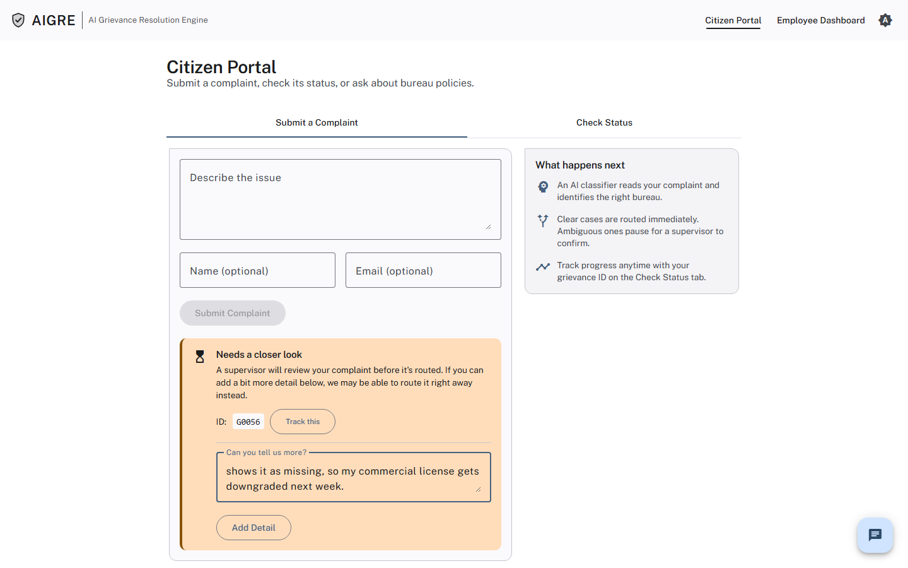

**Example — verified live:** adding *"Specifically, I submitted my CDL medical
examiner's certificate in August and my record still shows it as missing, so my
commercial license gets downgraded next week."* reclassifies the **combined** text (not
just the new sentence) and, since it's now confident, auto-resumes the same paused
workflow — no supervisor needed after all:

> **Routed to Driver Licensing Bureau**
> Category: cdl-medical-certificate · Priority: HIGH

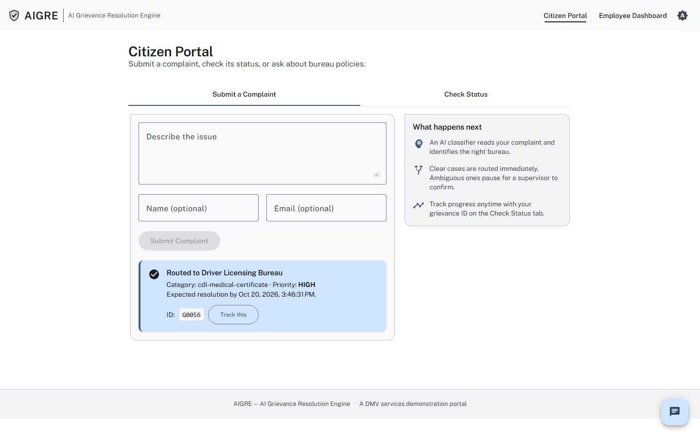

A clarification can also land on an existing open case. In one run, the added detail
described an insurance suspension that matched an open Financial Responsibility case of
the same category, so the resumed workflow linked it as a `DUPLICATE` of that case
rather than opening a second SLA clock. The banner still names the bureau, but shows no
SLA date.

If the added detail still isn't enough to classify confidently, the form reappears
once more (2 attempts total, not one-shot) — classification confidence has documented
run-to-run sampling variance (see `PROJECT.md`), so a second try genuinely has a real
chance of succeeding even with the same or similar wording. After 2 attempts, the case
stays parked for a supervisor with the fuller text saved either way, and the form
doesn't reappear — bounded, not an open-ended back-and-forth.

**Example 3 — out of scope:**

A city-service complaint (*"There's a huge pothole on Route 3 that blew out my tire."*),
a pure compliment for a clerk, or a dispute with a private seller comes back as **"Not
something this portal handles"** with the model's own one-line reasoning, rather than
being forced into a bureau's queue.

### Check Status

Paste a grievance ID, click **Check**. Returns a receipt-style card: status chip, the
complaint text and any added detail, bureau, category, priority, submitted date, SLA
due date, and resolution notes if any. Works for *any* grievance ID — one submitted
through the workflow, one submitted through the older plain-intake path, or a seeded
demo row — since it reads directly from the systems-of-record table rather than
depending on workflow state.

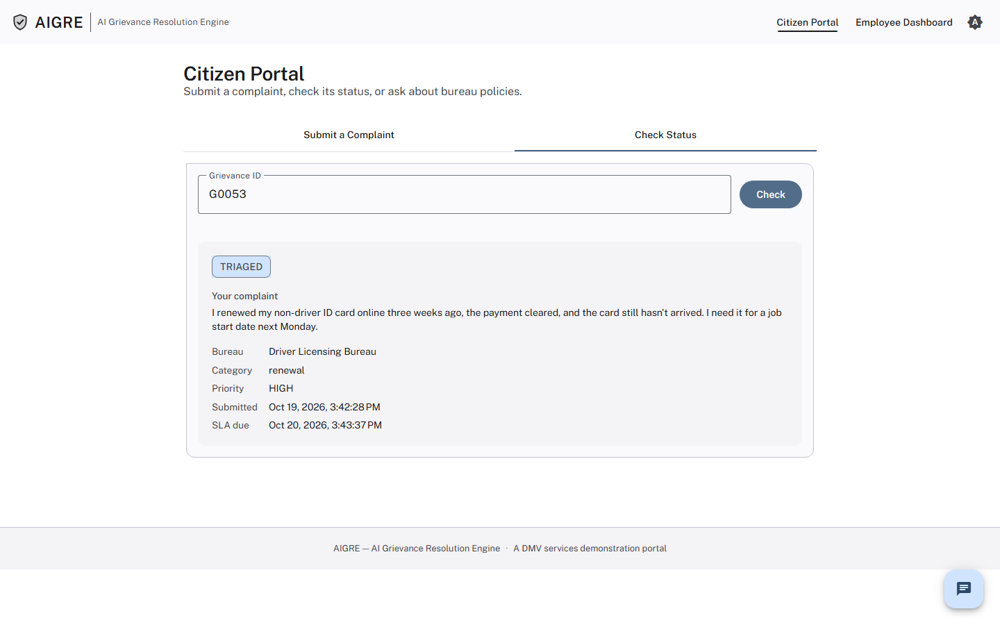

If a submission turns out to match an existing open report in the same bureau and
category, its status is **DUPLICATE** rather than a routed priority — it doesn't open a
second SLA clock, since the original report already has one.

If a grievance is **CLOSED**, the card offers a **Reopen this complaint** button — a
short reason, and the case comes back with its priority bumped one tier (capped at
CRITICAL) and a fresh SLA due date, routed back to the same bureau for another look.
Below, a lien-release case the Title bureau had closed is reopened with *"The title came
back but the lienholder is still listed, so I still cannot sell the car."* — `MEDIUM`
becomes `HIGH`, status `REOPENED`.

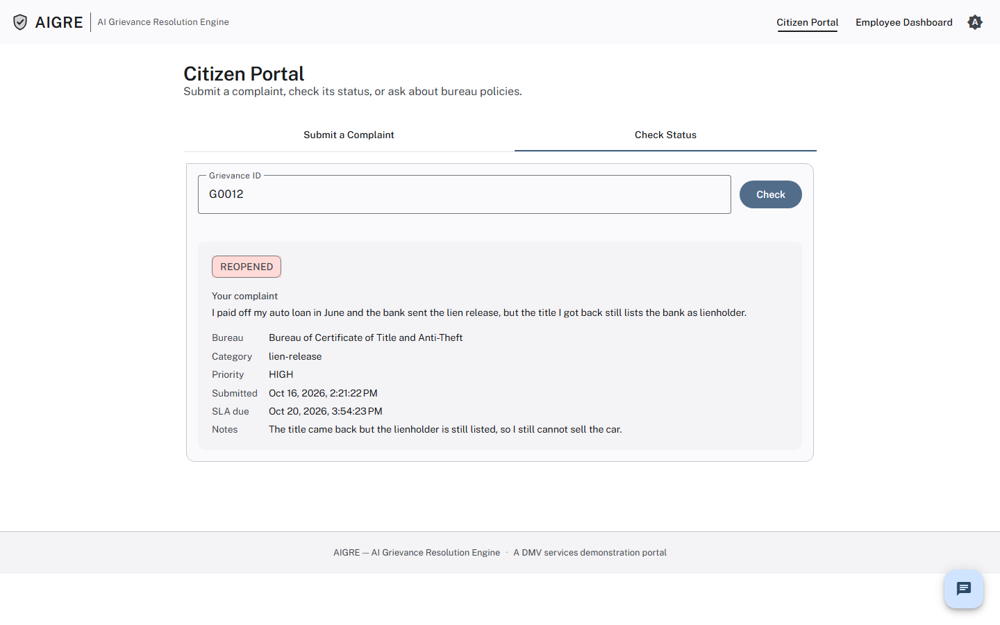

---

## Floating chat (available on every page)

A floating **Chat** button sits bottom-right on every page of the app — not just the
citizen portal — and opens a small panel backed by the RAG pipeline over the NH motor
vehicle rules (16 Saf-C chapters, filed by bureau). The empty state offers three
clickable example questions, which come from the profile's configuration. Answers
stream in token-by-token and end with citation cards for whatever was actually
retrieved and used.

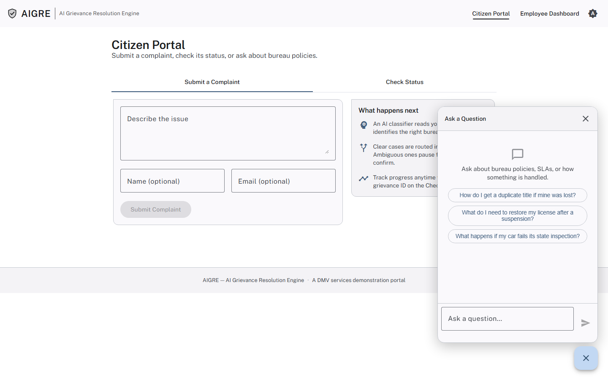

**Example — verified live:**

> *"How do I get a duplicate title if mine was lost?"*

> To get a duplicate title if your original title was lost, you should apply for a
> duplicate title on form TDMV 18, Application for Duplicate Certificate of Title. You
> will also need to submit a release of all liens and encumbrances, if applicable,
> along with the appropriate fee, as per RSA 261:20.

Citations: `SAF-C-1900` (the title chapter, which has the answer) and `SAF-C-1000`.
Saf-C 1000 is the largest general chapter in the corpus and wins a seat among the top
results for many questions; four of the sixteen retrieval eval questions lose their top
spot to it or to Saf-C 500 (see `PROJECT.md`, "Domain profiles").

If the corpus genuinely doesn't cover a question, the answer says so rather than
extrapolating from a related but different rule.

**A citizen who's submitted before is recognized automatically, with no login.**
Providing an email or phone at submission silently issues the browser a long-lived
recognition token (never shown or typed) — the chat then knows that browser's own
recent grievances, so a follow-up visit can ask "what's the status of my most recent
complaint" and get a real answer instead of "please provide a grievance ID":

**Example — verified live** (asked right after submitting, with an email, a complaint
that a new registration shows the plate number from the citizen's old car; no ID
given):

> *"What's the status of my most recent complaint?"*

> Based on the information provided, your most recent submission is G0062, which was
> submitted on 2026-10-19 15:58:15.795572. To check the current status of this
> complaint, I will use the `get_grievance_status` tool.
>
> The status of your most recent complaint G0062 is currently marked as NEW. It is
> predicted to be related to the REGistration department, and the priority is MEDIUM.
> […] Since there is no duplicate complaint chain and the SLA due date is not yet set,
> the next steps will be determined once the department reviews the complaint.

This still goes through the same live `get_grievance_status`/`check_sla_status` tool
calls described in `ARCHITECTURE.md`, not a guess — the model just no longer needs the
citizen to supply the ID by hand. (The model's prose says "department": tool output
uses the API's field names, and the chat prompt doesn't translate them.) Submitting
without contact info skips this entirely; chat behaves exactly as it does for any
anonymous citizen.

---

## Employee Dashboard (`/employee`)

Route-guarded — visiting it while logged out redirects to `/login`, a real Spring
Security + JWT sign-in (see `RUNNING.md` for the seeded demo accounts — two per bureau
plus `ops.admin`; every seeded account shares the password `Demo1234!`).

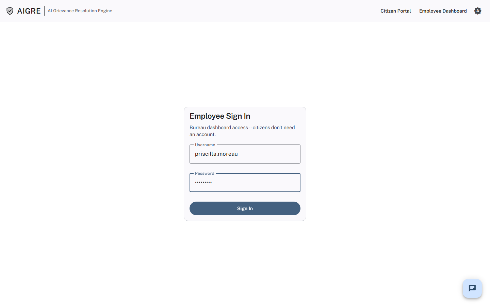

Once signed in, the toolbar shows the employee's name, bureau, and role. Dashboard
access is scoped strictly to that employee's own bureau, enforced server-side, not just
hidden in the UI: every query the dashboard makes is filtered to the logged-in
employee's bureau by the backend regardless of what the client asks for.

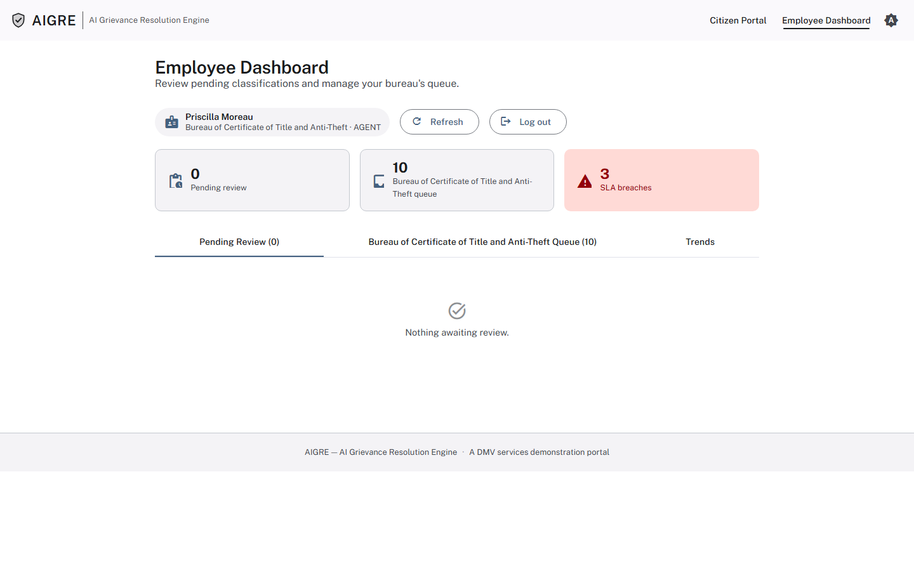

**AGENT vs. SUPERVISOR** — an AGENT can view their bureau's queue but not act on it:
opening a case shows the classification read-only. Here Priscilla Moreau (AGENT, Title
& Anti-Theft) opens a VIN-discrepancy case:

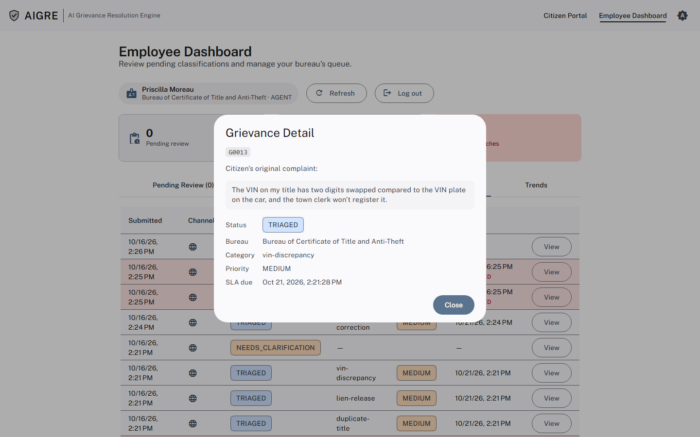

A SUPERVISOR (Dev Raman, same bureau) sees the same detail plus the actual controls — a
required note, a name, and **Start Work** / **Mark Resolved** / **Mark Closed** for an
open case (**Confirm & Route** for a paused review):

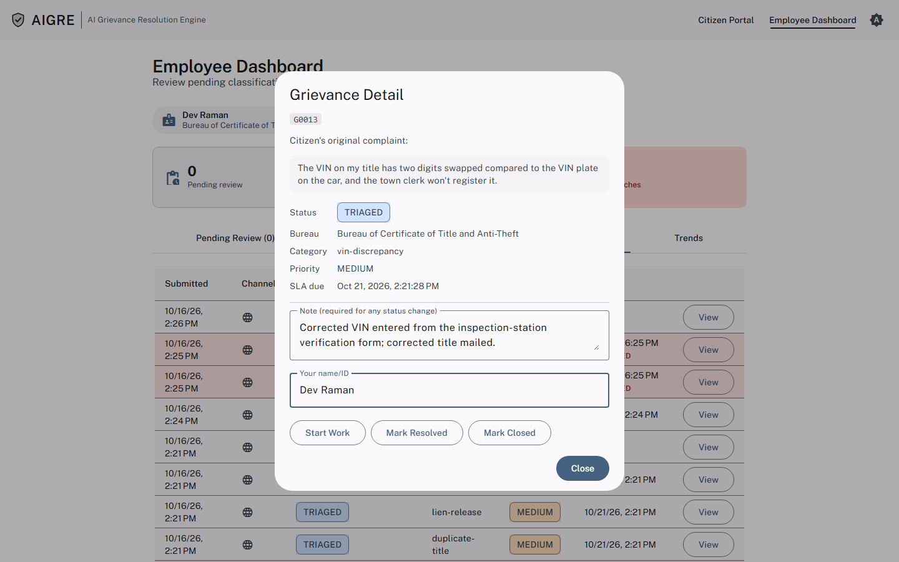

Below the toolbar, a 3-stat summary row: **Pending review** (count, own bureau),
**{bureau} queue** (count), **SLA breaches** (flagged red if non-zero — the two
CRITICAL title-theft and stolen-vehicle cases above, plus an escalated identity-fraud
case).

### Pending Review tab

A paginated table of every grievance currently paused at the human-review gate, scoped
like every other tab. A paused case with a predicted bureau shows in that bureau's
queue; one too vague to assign any bureau has none, so it waits for the division-wide
`ops.admin` — whose dashboard covers all bureaus, with an optional bureau filter.

Clicking **Review** opens a dialog showing:

- The citizen's original complaint text.
- Any follow-up detail the citizen added via the inline clarification form (see
  above), rendered as its own timestamped section distinct from the original
  complaint — not blended into one paragraph — since a supervisor needs to see at a
  glance what was added and when, not just that more text exists somewhere in the
  block.
- The LLM's confidence score and its reasoning (why it didn't commit to a guess).
- Editable Bureau / Category / Priority fields, each defaulting to "(keep as-is)" — a
  supervisor only needs to fill in what they're actually overriding.
- A required review note and "Reviewed by" field.

Here the citizen wrote *"Something is wrong with my car stuff and I keep getting the
runaround,"* then, asked for more, *"I think it might be the plates or maybe the title,
I'm honestly not sure which."* — still not enough to pick between Registration and
Title (confidence 0.3):

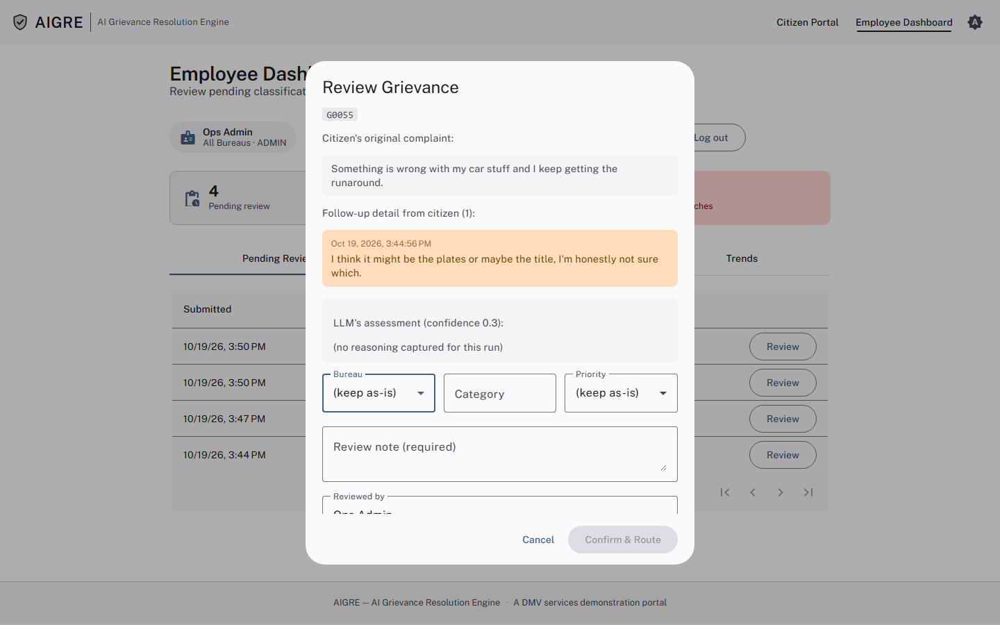

For *"My plates and my license both seem to have problems since I moved, and every
office sends me somewhere else."* (confidence 0.5), the reviewer assigns the
Registration Bureau and records why. Clicking **Confirm & Route** resumes the paused
LangGraph4j workflow with the decision; the grievance moves to `TRIAGED` with
`department_confirmed` now set (distinct from `department_predicted`, which still shows
what the AI originally guessed).

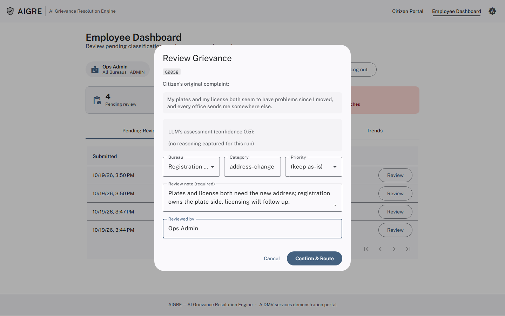

Both dialogs show "(no reasoning captured for this run)": `qwen3:8b` returned an empty
reasoning field for these classifications, so there was nothing to display.

Opening the dialog for a grievance that isn't paused shows a read-only detail view
instead of an editable form — there's nothing to approve for a case that never paused.
For a supervisor, any case that isn't already closed out (or a duplicate, or not
actionable) also offers the lifecycle actions: **Start Work** (`TRIAGED` → `ROUTED`),
**Mark In Progress**, **Mark Resolved**, **Mark Closed** — a note and a name/ID, and
the status updates immediately, with the queue table reflecting it on refresh. Below,
the VIN-discrepancy case after **Mark Resolved**:

### {Bureau} Queue tab

A paginated table scoped to the employee's bureau, any status: submitted date, channel
(portal or email), status, category, priority (color-coded chip), SLA due date, with a
red row highlight and **BREACHED** flag for anything past due and still open. **View**
opens the same detail dialog in its read-only mode.

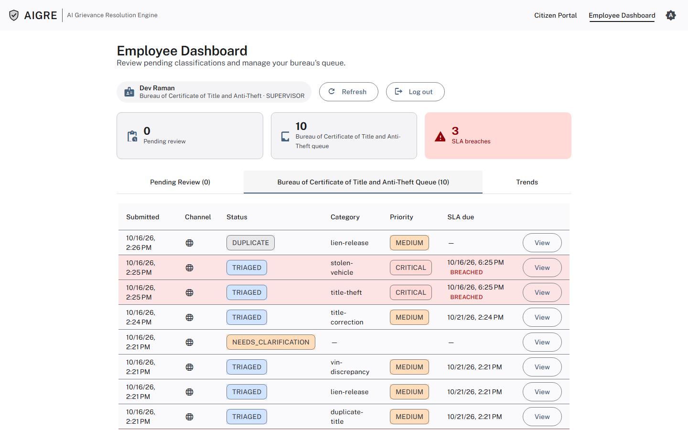

### Trends tab

Two independent toggles: **{the employee's bureau} / All Bureaus**, and a **7 / 30 / 90 day**
window. Four charts plus an SLA snapshot:

- **Volume over time** — daily complaint count, line chart.
- **Sentiment trend** — stacked bar chart, one bar per day, split into 5 named
  confidence bands (No Confidence / Low Confidence / Neutral / Moderate Confidence /
  High Confidence) rather than a single averaged number, so a day where sentiment was
  genuinely mixed looks different from a day where everyone landed in the same band —
  something one averaged line couldn't show.
- **Top categories** — bar chart, top 8 in the selected scope.
- **By priority** — bar chart, CRITICAL/HIGH/MEDIUM/LOW, color-matched to the same
  priority-chip colors used everywhere else in the app.
- **SLA snapshot** — three stat cards: *Resolved on time*, *Resolved late*, *Currently
  breached (open)*. Deliberately three numbers, not one "compliance %" — a closed-late
  case and a still-open breach are different problems worth seeing separately.

---

## What's real vs. demo-only

Worth being explicit about, since it affects how to read a walkthrough of a portfolio
project:

- **Real**: the LLM classification, the RAG retrieval/rerank/citation pipeline over the
  actual NH Saf-C rules, the LangGraph4j pause/resume workflow, the MCP tool server, the
  database and its aggregation queries, and employee authentication (Spring Security +
  JWT, bureau-scoped, role-gated). These all run against a live Ollama instance and a
  live Postgres instance — nothing in the walkthrough above is mocked.
- **Demo-grade, not production-grade**: the bureau staff, citizens and complaints are
  invented seed data, not NH DMV records, and the embed demo site is a stand-in, not
  dmv.nh.gov. All seeded employee accounts share one password, and the Trends tab's
  "All Bureaus" toggle is deliberately *not* bureau-restricted (aggregate/statistical,
  not case-level data — a narrower reading of "own bureau only" than the
  case-management views). `RESOLVED`/`CLOSED`, `ROUTED`/`IN_PROGRESS` ("Start
  Work"/"Mark In Progress"), and `REOPENED` (citizen-facing) all have real dashboard
  actions — a supervisor can move a triaged case through the full working lifecycle,
  not just approve its classification and close it out.
